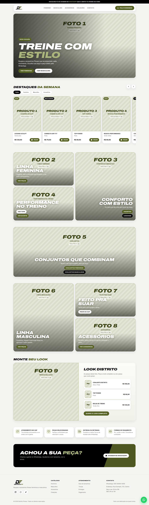

# LP Distrito Fit

Landing page / catálogo da **Distrito Fitness**: roupas e acessórios fitness, com pedidos pelo WhatsApp.



## Como editar

- **Número do WhatsApp:** no `index.html`, troque `const WHATSAPP = "5500000000000"` (55 + DDD + número).
- **Produtos:** edite a lista `PRODUTOS` no `index.html` (nome, cor, preço, categoria, tag).
- **Fotos:** salve na pasta `fotos/` com os nomes indicados em [`fotos/LEIA-ME.txt`](fotos/LEIA-ME.txt).
- **Cores da marca:** variáveis no topo do CSS (`--preto`, `--verde`).

## Rodar localmente

```bash
npx http-server -p 5173 .
```
